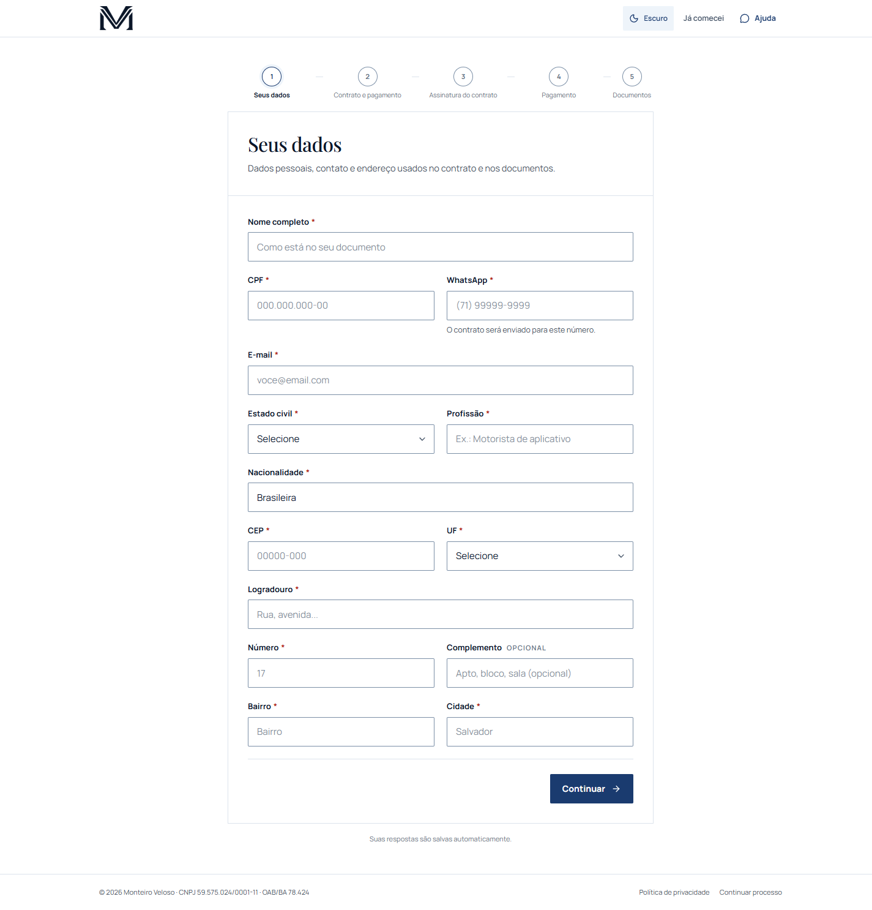
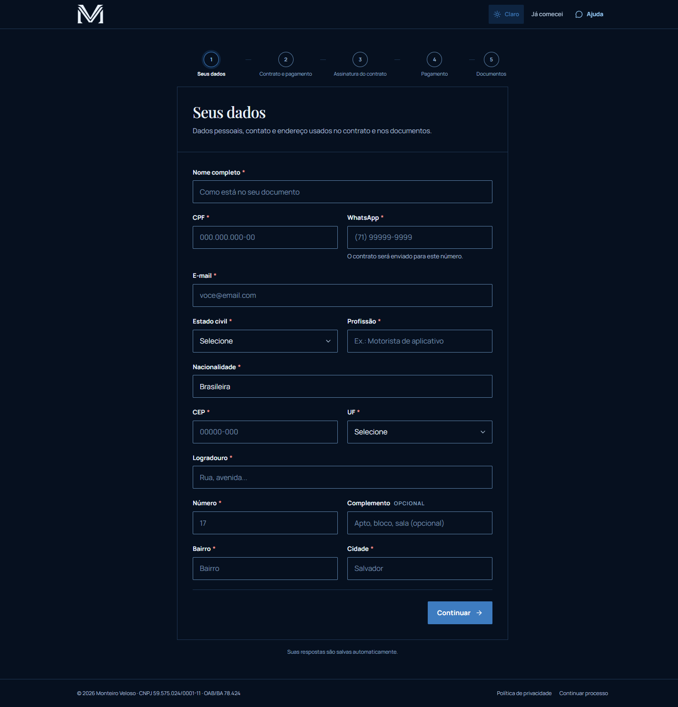
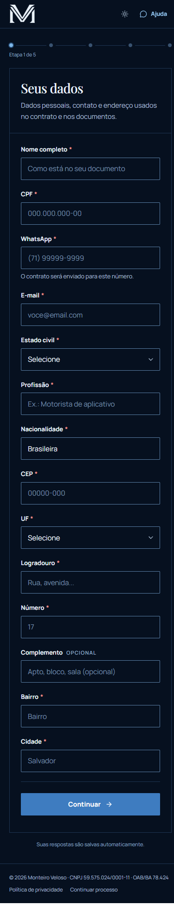

# Central de contratação — Monteiro Veloso Advogados

Aplicação web de onboarding de clientes do escritório: formulário público, geração e assinatura de contratos, cobrança, upload de documentos e acompanhamento operacional.

> **Status:** Fase 1 concluída no escopo do formulário público — fluxo compacto de 5 etapas (dados → contrato/pagamento → assinatura → pagamento → documentos), tema claro/escuro, autosave, CEP automático, assinatura pelo ZapSign com envio por WhatsApp, checkout do Asaas, confirmação por webhook e testes E2E. Formulário ativo em `https://form.monteiroveloso.com`; Supabase cloud com migrations, seed e Edge Functions. Falta configurar o token real do template ZapSign e a API key do Asaas. Veja `docs/roadmap.md`, `docs/functions.md` e `docs/deploy.md`.







## Stack

| Camada | Tecnologia |
| --- | --- |
| Frontend | React 19 + TypeScript + Vite 8 |
| Estilo | Tailwind CSS v4 com os tokens da landing |
| Roteamento | React Router |
| Dados | TanStack Query |
| Formulários | React Hook Form + Zod |
| Backend | Supabase Edge Functions (Deno) |
| Banco | Supabase Postgres + RLS |
| Arquivos | Supabase Storage (staging) → Google Drive |
| Deploy | Vercel (frontend) + Supabase (API/DB) |

## Como rodar

```bash
npm install
cp .env.example .env.local
npm run dev
```

O padrão é `VITE_API_MODE=mock`: o fluxo completo funciona sem backend, com dados no `localStorage` e botões de simulação de webhook. **Não use esse modo em produção.**

Para o ambiente real:

```bash
npx supabase start
npx supabase db reset
npx supabase functions serve
```

Preencha `.env.local` com `VITE_SUPABASE_URL`, `VITE_SUPABASE_ANON_KEY` e `VITE_API_MODE=http`. Os segredos das integrações ficam em `supabase secrets`, nunca no frontend.

## Variáveis de ambiente

O `.env.example` é focado em **Supabase + app** e está dividido em:

1. Supabase frontend (`VITE_SUPABASE_*`)
2. Aplicação (`VITE_APP_URL`, `VITE_API_MODE`)
3. Supabase CLI/deploy (`SUPABASE_ACCESS_TOKEN`, `SUPABASE_PROJECT_REF`, `SUPABASE_DB_PASSWORD`)
4. Supabase Edge Functions (injetadas pelo runtime)

As chaves privadas de ZapSign, Asaas, Google Drive, Infinitum, Vertisell e e-mail estão em `docs/functions.md`. Regra:

- `VITE_*` → Vercel (público, entra no bundle)
- `*_SECRET`, `*_TOKEN`, `SERVICE_ROLE` → Supabase Edge Functions Secrets

## Scripts

| Script | O que faz |
| --- | --- |
| `npm run dev` | Vite em `http://localhost:5173` |
| `npm run build` | typecheck + build de produção |
| `npm run typecheck` | TypeScript sem emitir |
| `npm test` | testes de domínio (Vitest) |
| `npm run test:e2e` | testes E2E (Playwright) |
| `npm run test:e2e:ui` | Playwright em modo UI |
| `npm run lint` | ESLint |
| `npm run db:start` | sobe o Supabase local (Docker) |
| `npm run db:reset` | reaplica migrations + seed |
| `npm run gen:types` | gera tipos do banco |

## Estrutura

```text
src/
  app/              # rotas, layouts e shell
  features/         # uma pasta por capacidade de negócio
    start-process/
    process/        # domínio + repositórios do processo
    process-wizard/
    process-status/
    admin-auth/
    admin-dashboard/
    admin-processes/
    privacy/
  shared/
    domain/         # CPF, telefone, dinheiro, datas, vencimentos
    ui/             # componentes base
    lib/            # utilidades sem regra de negócio
    theme/          # tema claro/escuro
    config/         # env, marca, rotas
    api/            # tipos gerados do banco
    supabase/       # client do admin
supabase/
  migrations/       # schema, RLS, RPCs
  functions/        # Edge Functions
  seed.sql          # produto piloto + feriados
tests/
  e2e/              # Playwright
docs/
  data-model.md
  architecture.md
  api-contract.md
  functions.md
  deploy.md
  roadmap.md
  decisions/
```

Cada feature segue as camadas `domain → application → infrastructure → ui`, com `index.ts` como API pública. Regras de negócio não ficam em componentes.

## Identidade visual

Os tokens e as fontes vêm da landing (`../monteiro-veloso-advogados`): navy/paper, Playfair Display + Manrope, raio de 2 px, réguas de 1 px, sem sombras decorativas. A fonte da verdade visual é `src/styles/global.css`; ao mudar a landing, sincronize o bloco `@theme` e os arquivos em `public/fonts`.

## Segurança

- Nenhum segredo no bundle: somente variáveis `VITE_*` públicas.
- `anon` não acessa tabelas; o público passa por Edge Functions.
- RLS para o admin, com papéis e mascaramento de CPF.
- Token de processo opaco, sem IDs sequenciais.
- Idempotência e outbox no banco.
- Cabeçalhos de segurança e CSP em `vercel.json`.

Leia `docs/architecture.md` antes de mexer nas integrações.
